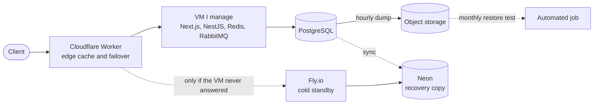

# Kauan Pardini Augusto

Back-end and full stack developer in Curitiba, Brazil, finishing Software Engineering at PUCPR. Mostly Node.js, TypeScript and PostgreSQL, plus Java and Spring. I'm looking for a junior or mid-level role, remote or in Curitiba.

## Work

**Beauty Max Tecnologia**, Software Developer, since April 2026. A multi-tenant SaaS for beauty businesses and the group's internal support platform.

- The blue/green pipeline that replaced the in-place PM2 deploy (staging, migration dry run, health checks, rollback slot) carried 211 production releases in 11 weeks.
- I built the WhatsApp assistant that answers and books appointments with an LLM. It only got write access after passing an 18-case offline eval, and a person can take over or switch it off at any time.
- Payment reconciliation never matches on amount. It uses the invoice ID we write into the checkout metadata, runs as a dry run by default and sends anything ambiguous to a person.
- Two operators opening the same cash register at once used to be a 500. Now it's a row lock, a unique index and a 409.
- The help desk moved to GLPI 11 in containers. Full rehearsal with matching row counts: about 4 minutes, against a 30-45 minute estimate.

## A construction management SaaS I run in production

Personal project. Modular monolith (NestJS and Next.js, 35 API modules), shared-schema multi-tenancy, 32 Docker Compose services across production, staging and monitoring. The code is private, so this is how it's built and what I measured.

| Change | Before | After | What fixed it |
| --- | ---: | ---: | --- |
| Dashboard p99, k6 at 12 req/s in production | 3.3 s | 210 ms | Released the SSR payload right after render. The web tier had been restarting on heap under load |
| First request after an idle period | 110 ms | 20 ms | Kept the Postgres pool warm. The driver's 10 s idle timeout was draining it |
| Cached page at the edge | 60 ms | 28-41 ms | Normalized the Next.js `Vary` header that was silently disabling the Worker cache |
| Managed database compute | 1.99 CU-h/day | 0.07 CU-h/day | Moved the primary to self-hosted Postgres with 5 days left on the quota |
| Restore from backup | not tested | 14-17 s | Hourly dumps, checked every month by an automated restore job |

Each change has a dated note with the command, the source and the window, including the changes that didn't help. A request that changes data is never retried on the standby once the primary has replied.

## Public projects

**[CTAIO Locale Rescue](https://github.com/J4kedi/ctaio-locale-rescue)** ([live page](https://j4kedi.github.io/ctaio-locale-rescue/)). Three of the six hreflang locales a public site declared answered 403. A Node script with no dependencies now emits hreflang only for locales that were actually built.

**[ConstructionCon](https://github.com/J4kedi/constructioncon-marketplace-bff)**. University project, from a multi-tenant monolith to a microservices proof of concept: Node catalog on MongoDB, [Spring Boot orders on SQL Server](https://github.com/J4kedi/constructioncon-marketplace-orders-svc), a BFF and a microfrontend.

**[API-Rest-Java](https://github.com/J4kedi/API-Rest-Java)**. Java 21 and Spring Boot 3 with Spring Security/JWT, JPA, Flyway and tests. A study project from a course.

**[Kurio](https://github.com/J4kedi/frontend-challenge)** ([demo](https://kurio-nft-marketplace-vert.vercel.app)). Front-end challenge in React 19 and TanStack, with Playwright E2E and visual tests.

From university: a [cache simulator](https://github.com/J4kedi/t1a-cache-mapeamento-direto-python) with unit tests and a [process precedence graph](https://github.com/J4kedi/tde_performance) with semaphores.

## Stack

- Daily: TypeScript, Node.js, NestJS, Next.js, React, PostgreSQL, Redis, RabbitMQ, Docker, GitHub Actions
- Also used: Java 21, Spring Boot 3, PHP, MariaDB, SQL Server, MongoDB
- Operations and tests: Cloudflare Workers, Linux, Nginx, Prometheus, Grafana, Loki, Jest, Playwright, k6

## Contact

kauanpardini@gmail.com, or [LinkedIn](https://www.linkedin.com/in/kauan-pardini-augusto-7b132b210/).
